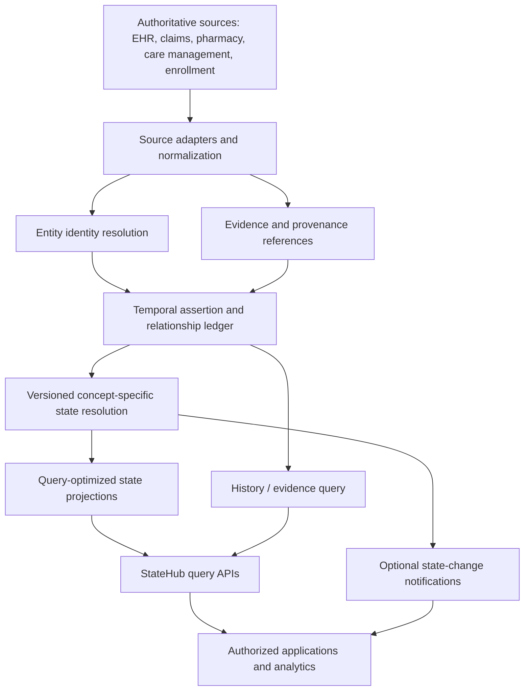
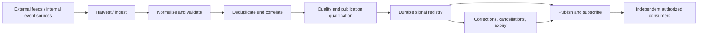
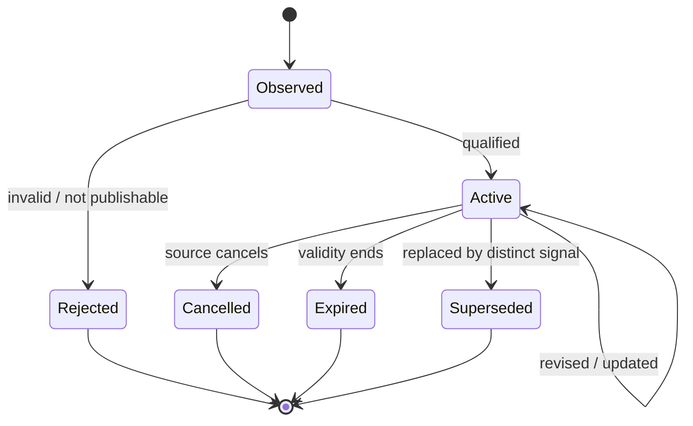

# StateHub and SignalHub
## Two Independent, Complementary Capabilities for Longitudinal State and Proactive Awareness

**Document type:** Architecture and product proposal  
**Status:** Working design — for review and iteration  
**Version:** 1.0  
**Date:** October 14, 2026  
**Primary domain:** Healthcare (designed to be reusable beyond healthcare)

---

## 1. Executive Summary

Healthcare organizations rarely lack data. They lack a dependable way to answer two practical questions across fragmented clinical, operational, and external systems:

1. **What do we know about this entity, and what did we know at a particular point in time?**
2. **What has happened or is happening that may change how we understand or respond to the world?**

These are related, but fundamentally different capabilities. A patient's historical diagnoses, prior admissions, known care gaps, medications, relationships, and current care status are not the same kind of information as a new discharge notification, a heat advisory, a medication-fill event, or a nearby community-service closure. One describes a continuously evolving understanding of entities; the other describes new observations and conditions that may be relevant to consumers.

We propose two independently deployable and consumable platform products:

- **StateHub** provides a longitudinal, temporal, evidence-backed understanding of entities and their relationships. It exposes observed facts, their provenance, conflicts and uncertainty, historical views, and resolved current-state projections. StateHub is a *logical capability*, not a mandate to use a graph database, build one universal member profile, or replace source systems of record.
- **SignalHub** discovers, ingests, normalizes, correlates, qualifies, and distributes significant events and changing conditions from internal and external sources. It maintains signal identity, scope, relevance metadata, freshness, and lifecycle. SignalHub is not merely an event bus, not a universal clinical decision engine, and not a workflow orchestrator.

**Together:** SignalHub can observe that a member was discharged today or that a severe heat advisory affects an area. StateHub can answer what is known about that member, their encounters, relevant conditions, and location relationships. Consumers may use either independently or combine both to support care management, HEDIS and quality operations, population health, utilization management, outreach, analytical applications, and AI-assisted experiences.

The architecture intentionally separates **observations, evidence, resolved state, and signal relevance**. It must not confuse an unconfirmed diagnosis with a confirmed one; a care gap with a missing service; a received event with an event that occurred today; or a weather alert affecting a geography with a verified risk to every resident.

> **Working product definitions**
>
> **StateHub:** The platform capability for evidence-backed understanding of entities, relationships, and their evolving state across time.
>
> **SignalHub:** The platform capability for continuously discovering, qualifying, tracking, and distributing potentially relevant changes in the world.

### 1.1 The primary design decision

**Keep the products separate, share a small vocabulary, and permit optional integration.** StateHub should work even if SignalHub does not exist. SignalHub should publish valuable signals even if StateHub is unavailable. Neither should become the universal control plane for the other.

### 1.2 What success looks like

A consumer should be able to:

- Ask StateHub, *“What do we currently know about Member M123's discharge history and care status, and which sources support those answers?”*
- Ask StateHub, *“What was believed to be true on September 1, based on information available by September 3?”*
- Subscribe to SignalHub for *“new discharges for my authorized population”* or *“severe heat alerts affecting the counties where we operate.”*
- Trace a delivered signal to a source event, view subsequent corrections/cancellations, and determine whether the signal is still active.
- Combine both without letting a weakly inferred risk overwrite a verified clinical record.

The goal is not to centralize every dataset or automate every response. The goal is to make **knowledge and change** dependable, accessible, interoperable, and auditable.

---

## 2. The Problem These Systems Address

### 2.1 Fragmented longitudinal understanding

A single member's story may be split across EHRs, claims, pharmacy feeds, encounter notifications, case-management applications, quality-measure systems, enrollment records, community-resource systems, and contact-center notes. The systems may disagree. Their refresh frequencies differ. Their identifiers differ. New data can describe old events. A missing claim may mean “not yet received,” not “care did not happen.”

Most applications independently solve some portion of this problem: entity matching, record normalization, timeline reconstruction, source precedence, evidence inspection, and current-state calculation. This creates inconsistent definitions and duplicative work.

**StateHub** should make these capabilities reusable without pretending that it is the authoritative clinical record or that every concept has one definitive truth.

### 2.2 Poor awareness of emerging events

Important changes arrive through ADT notifications, FHIR resources, claims, lab results, scheduling systems, member communications, public-health feeds, weather alerts, and partner APIs. Traditional ingestion platforms can deliver these records, but often do not provide a reusable notion of:

- The *same* signal arriving more than once or being corrected.
- When the signal became valid and when it stopped being relevant.
- Whether it applies to one member, a provider, a facility, a region, or a population.
- Whether it is reliable and fresh enough to publish.
- Which authorized applications should be told and with which fields.

**SignalHub** should provide that consistent awareness layer, above transport and below application-specific decisions.

### 2.3 Why one combined mega-platform is the wrong default

The first problem optimizes for historical completeness, temporal correctness, state interpretation, and explainable queries. The second optimizes for source responsiveness, filtering, deduplication, lifecycle transitions, subscriptions, and delivery. Combining them into a single mandatory runtime introduces avoidable coupling across uptime, scaling, governance, and release cycles.

A well-defined interaction between two services is preferable to one service that owns ingestion, identity, longitudinal knowledge, rule engines, user-facing actions, and workflow execution.

---

## 3. Product Positioning and Boundaries

| Dimension | StateHub | SignalHub |
|---|---|---|
| Foundational question | What do we know, and when did we know it? | What happened, is happening, or may change? |
| Primary product | Longitudinal evidence-backed entity understanding | Event and emerging-condition awareness |
| Dominant access pattern | Query, temporal lookup, relationship lookup, evidence inspection | Subscribe, query active/recent signals, inspect lifecycle |
| Typical data | Assertions, facts, entity links, historical events, current-state views | Raw source references, normalized events, qualified signals, scope, status |
| Time concerns | Effective time; knowledge/recording time; historical revisions | Event time; detected time; valid window; expiry; correction time |
| Ownership | State derivation and evidence linkage | Signal detection, normalization, qualification, distribution |
| Storage expectation | Flexible: relational, document, lakehouse, graph projections | Flexible: event log, durable signal registry, indexes and subscriptions |
| Consumers | Applications, analytics, AI services, care teams through applications | Applications, alerting systems, population programs, analytics |
| Not responsible for | Replacing all source systems, universal decisioning, all ingestion | Clinical truth, complete member history, care actions, process orchestration |

### 3.1 Non-goals

**StateHub is not:**

- A mandatory graph database or knowledge-graph program.
- A replacement for EHR, claims, pharmacy, enrollment, or other source-of-record platforms.
- An unrestricted consolidated PHI lake exposed behind one API.
- A system that silently collapses conflicting evidence into a single unquestioned value.
- A clinical diagnosis or treatment recommendation engine.

**SignalHub is not:**

- Another generic Kafka wrapper renamed “signal processing.”
- A place to persist every healthcare record permanently in its original structure.
- The sole enterprise identity service or member master index.
- An engine that independently decides whether a particular patient needs clinical intervention.
- A system that launches business processes or contacts members without consumer governance.

### 3.2 Beyond healthcare

The design can generalize to providers, organizations, locations, assets, customers, facilities, and operating environments. Healthcare provides demanding early examples because time, identity, evidence, policy, and data sensitivity matter acutely. The first release should nevertheless remain opinionated about a **small set of healthcare use cases**, not try to model the entire enterprise.

---

## 4. Shared Conceptual Model: Agree on Semantics Before Technology

The two products should use a small, explicit vocabulary. These concepts overlap in the real world but should remain distinct at the API and ownership level.

| Concept | Definition | Healthcare example | Primary stewardship |
|---|---|---|---|
| **Entity** | A distinguishable real-world person, place, organization, or thing | Member, provider, facility, encounter, county | Shared identifiers; StateHub query representation |
| **Source record** | A record or message obtained from an upstream system | FHIR Encounter, claim line, ADT message | Original source; references retained locally |
| **Observation** | Something observed, reported, received, or measured | “BP recorded at 142/88”; “ADT says discharged” | Ingestion and evidence pipeline |
| **Evidence** | Traceable support for an assertion, including source version and processing lineage | Encounter ID, document section, claim reference | StateHub evidence linkage; source remains authoritative |
| **Assertion / fact** | A typed claim about an entity; may be reported, verified, computed, disputed, or retracted | “M123 received vaccine on 2026-02-12” | StateHub |
| **Relationship** | A typed connection between entities with its own time and evidence | Member assigned to Dr. A; member resides in Area B | StateHub |
| **State** | A point-in-time view resolved from relevant assertions under a specified policy | “Current encounter status: discharged” | StateHub |
| **Event** | A recorded occurrence or transition | Admission, discharge, appointment cancellation | Source / normalized event pipeline |
| **Signal** | An event, change, or environmental condition identified as potentially relevant and managed through a lifecycle | “Discharge detected”; “heat advisory active in Area B” | SignalHub |
| **Situation** | A derived, time-bounded interpretation produced by combining evidence, state, and/or signals | “Recently discharged; no documented follow-up yet” | Explicitly named consumer or assessment component |

**Important:** These are conceptual distinctions, not a requirement to create ten different databases, topics, microservices, or JSON objects. A hospital discharge can be an event represented as an assertion in historical knowledge *and* be surfaced as a new signal. The two representations serve different purposes and must be connected through identifiers and provenance, not conflated.

### 4.1 From observations to knowledge

An incoming claim, FHIR resource, or document statement does **not** automatically become an unquestionable fact. For example:

1. A note mentions a suspected condition.
2. The statement becomes an attributed observation, with its author, document, date, and extraction method.
3. The system may store an assertion whose status is **suspected** or **reported**, not **confirmed**.
4. A future signed clinical record may strengthen, contradict, or supersede that assertion.
5. A current-state view resolves the evidence according to an explicit, versioned policy appropriate for the concept.

A useful rule is: **evidence is append-oriented; interpretations can change; prior interpretations remain reconstructable.**

### 4.2 Unknown is not false

For HEDIS and care gaps, this matters particularly:

- “No evidence of vaccination in the records currently available” is not the same as “the patient did not receive a vaccination.”
- “No completed follow-up appointment appears in the scheduling system” is not the same as “no follow-up care occurred.”
- “Medication appears on an active list” is not equivalent to “the member is taking it.”

StateHub must represent missing, incomplete, contradictory, and delayed information explicitly. This avoids injecting false certainty into downstream applications.

### 4.3 Temporal semantics and the importance of two clocks

At minimum, both systems should distinguish:

- **Occurred / event time:** When something happened in the real world.
- **Effective / valid time:** When an assertion or condition applies in the world.
- **Source recorded / published time:** When the originating organization recorded or released it.
- **Received / ingested time:** When our platform observed it.
- **Superseded / retracted time:** When we learned that previous information should no longer be treated as current.

StateHub needs **bitemporal-capable queries** where feasible: what was true for a given effective date **and** what the platform knew as of a given knowledge date. A claim received in October describing an August service should affect the August clinical timeline without pretending the service took place in October.

**Example:**

- August 8: A screening was performed.
- September 1: A care-gap report showed “no evidence received.”
- October 14: The screening claim was ingested and linked to the August event.

A query for *clinical activity in August* now includes the screening. A query for *what was known on September 1* must still reproduce the original evidence gap.

SignalHub needs an analogous distinction between the time a heat advisory applies, when it was issued, when it was discovered, and when it was later canceled or replaced.

### 4.4 Identities, terminology, and ontology

Entity identity and domain terminology matter, but they are **shared dependencies**, not reasons to turn either product into a universal semantic platform.

- Resolve members through an enterprise identity service or governed master index; preserve source identifiers and link confidence.
- Distinguish encounter IDs, admission episodes, claims, and document IDs; do not assume one-to-one correspondence.
- Reference approved clinical code systems and terminology mapping services where required (e.g., diagnosis, lab, medication, encounter type).
- Support typed entity relationships even when physical persistence is relational or document-based.
- Avoid building an enterprise-wide ontology before the first working products. Start with a compact domain model and extensible code systems.

---

## 5. StateHub: Product Design

### 5.1 Definition and responsibilities

**StateHub is a reusable, evidence-backed, temporal entity-state capability.** It lets authorized consumers discover what has been observed, inspect supporting evidence, understand entity relationships, and retrieve present or past state without independently rebuilding longitudinal interpretation.

StateHub owns **knowledge representation and state projection**, not original clinical truth. A source may revise its data; StateHub should reflect that revision without erasing what it previously knew.

Its responsibilities are:

1. Resolve canonical entity references from permitted upstream identifiers.
2. Ingest or reference relevant source assertions and observations.
3. Preserve provenance, source versions, time, and sensitivity/usage metadata.
4. Track conflicting, corrected, and retracted assertions.
5. Maintain typed, time-qualified relationships between entities.
6. Compute authorized and reproducible current-state projections.
7. Provide temporal queries, entity views, evidence lookup, and change notifications.
8. Expose enough freshness and confidence/verification information for consumers to make informed decisions.

### 5.2 What StateHub should store or expose

Organize the logical model by type of knowledge rather than by producing system.

**A. Longitudinal facts and observations**

- Encounters, admissions, transfers, and discharges.
- Diagnoses and problems, preserving confirmation and status.
- Laboratory measurements and selected clinical observations.
- Procedures, screenings, immunizations, and medication-related records.
- Enrollment and program participation history.
- Previous outreach attempts and documented outcomes when legitimately reusable.

**B. Current or resolved state**

- Current known encounter status.
- Active documented care-team relationships.
- Active program enrollment and eligibility as reported by authoritative sources.
- Current care-gap assessment **with evidence and methodology version**.
- Medication-list state with clearly stated meaning (ordered, dispensed, reconciled, self-reported).
- Relevant location relationships with effective periods.

**C. Relationships**

- Member → provider / care team.
- Member → encounter → facility.
- Member → geographic service area.
- Encounter → diagnosis / procedure / source document.
- Member → care program / documented caregiver relationship.

**D. Derived and evaluated assertions**

- Risk scores generated by identifiable models.
- Document-extraction claims with review status.
- Evidence-based quality-measure interpretations.
- Time-bounded statuses such as “recently discharged.”

Derived assertions must reference the method or model version that produced them and must not masquerade as directly observed clinical facts.

### 5.3 Reference logical architecture



This is a **logical** diagram. Adapters, ledger, resolution logic, and projections need not all be independently deployed services in the MVP.

### 5.4 Assertion model

Illustrative schema (not a universal healthcare standard):

```yaml
assertion_id: ast_9482
subject:
  entity_type: member
  entity_id: M123
predicate: encounter.status
value:
  code: discharged
  system: internal.encounter-status.v1
related_entities:
  - entity_type: encounter
    entity_id: E789
  - entity_type: facility
    entity_id: F014
assertion_kind: source_reported    # source_reported | verified | derived
verification_status: reported     # not equivalent to clinical confirmation
valid_time:
  from: '2026-10-14T09:00:00Z'
  to: null
knowledge_time:
  recorded_at: '2026-10-14T09:04:00Z'
  superseded_at: null
source:
  system: hospital_adt
  record_id: adt-msg-9981
  record_version: '1'
  evidence_uri: 'evidence://hospital_adt/adt-msg-9981/1'
resolution:
  resolver_version: encounter_status_v1
  precedence: authoritative_adt
policy_labels:
  - phi
status: active
```

**Illustrative design choices:**

- `predicate` describes the kind of assertion, not a free-text field name invented by each adapter.
- `valid_time` concerns the real-world state; `knowledge_time` concerns when the platform knew it.
- `source` permits inspection or retrieval of evidence under applicable permissions.
- `assertion_kind` and `verification_status` separate reported information from a confirmed fact or derived prediction.
- A later correction creates a new ledger version or an explicit supersession event; it does not silently mutate historical evidence.

### 5.5 State resolution is policy-driven, not a universal merge function

It may be tempting to define one “golden record” merge algorithm for all attributes. That is unsafe and impractical.

| Concept | Illustrative resolution approach | Why |
|---|---|---|
| Enrollment status | Contractually authoritative enrollment source | Eligibility differs from clinical inference |
| Encounter status | Prioritize verified encounter/ADT updates; handle corrections | Messages can arrive late or out of order |
| Diagnoses | Preserve sources and clinical status; do not simply select latest text | Suspected, ruled-out, billing, and active diagnoses differ |
| Immunization evidence | Keep multiple supporting events; deduplicate clinical event identity | Claims and EHR records may describe the same administration |
| Current medication | Maintain separate prescribed, dispensed, reconciled, and patient-reported views | They are not equivalent to adherence |
| Care-gap status | Run a versioned measure assessment over available evidence | “Open” is a calculation, not primary clinical truth |

Each concept can have its own resolver with explicit input types, source precedence, clinical or business ownership, versioning, and test fixtures. Some concepts should remain **multi-valued or unresolved** rather than forcing one winner.

### 5.6 Read and query interfaces

Start with purposeful APIs, not arbitrary graph-query exposure:

```http
GET /v1/entities/member/M123
GET /v1/entities/member/M123/state?concept=encounter.status
GET /v1/entities/member/M123/timeline?from=2026-07-01&to=2026-10-15
GET /v1/entities/member/M123/relationships?type=care_team
GET /v1/assertions/ast_9482/evidence
POST /v1/state/query
```

The **query body** can support more precise temporal semantics:

```json
{
  "entity": {"type": "member", "id": "M123"},
  "concepts": ["encounter.status", "care_program.enrollment"],
  "valid_at": "2026-09-01T12:00:00Z",
  "known_at": "2026-09-03T12:00:00Z",
  "include": ["evidence_summary", "freshness", "conflicts"]
}
```

The effective caller identity, purpose of use, tenant, and authorizations must be provided and verified by the identity/policy enforcement architecture. A free-form `purpose` passed by a caller must **not** itself grant access. Every response is filtered by authorization and source constraints.

### 5.7 Example response semantics

A useful answer is not merely `status: discharged`. It should indicate:

- Status: **discharged**.
- Effective time: **2026-10-14 09:00 UTC**.
- Knowledge time: **2026-10-14 09:04 UTC**.
- Source: **hospital ADT**.
- Verification/source status: **reported by source**.
- Evidence: **authorized link to the encounter notification**.
- Freshness: **source last processed at ...**.
- Conflicts: **none / unresolved / suppressed with explanation**.

This allows applications to distinguish an authoritative current state from a plausible but delayed projection.

### 5.8 Physical architecture options

| Pattern | Strengths | Trade-offs | Suggested use |
|---|---|---|---|
| Central fact store | Fast unified queries and explicit history | Replication costs; policy scope; ingestion complexity | A narrow governed set of high-value assertions |
| Virtual federation | Keeps data near source; limits duplication | Variable latency/availability; difficult as-of reproducibility | Large or sensitive records not needed locally |
| Event-sourced ledger with projections | Auditable history and replay | Operational and schema-evolution complexity | When historical reconstruction is central |
| Graph projection | Powerful relationship traversal | Another index and lifecycle to maintain | Only for proven multi-hop relationship needs |
| **Hybrid logical StateHub** | Flexible by concept and consumer | Requires clear routing and freshness semantics | **Preferred target** |

**Recommended beginning:** A compact append-oriented assertion store, relational current-state projections, evidence references, and a small number of well-governed entity relations. Add graph projections only where measured query patterns justify them. The name **StateHub** intentionally avoids imposing a graph implementation.

---

## 6. SignalHub: Product Design

### 6.1 Definition and responsibilities

**SignalHub is a reusable system for proactive awareness.** It continuously harvests or receives observations from internal and external sources, interprets them into stable typed events, determines whether they meet reusable publication criteria, tracks their lifecycle, and distributes them to authorized consumers.

SignalHub should support both immediate push events and changes discovered through polling or scheduled data refreshes. A signal does not need to concern a member; it can concern a geographic area, healthcare facility, provider network, service line, population, or other entity.

Its responsibilities are:

1. Register and manage source connectors and their operational health.
2. Ingest events, alerts, feeds, and detected changes.
3. Preserve raw-source references for provenance and replay.
4. Normalize source-specific events to versioned signal types.
5. Deduplicate retries and correlate revisions to the same underlying condition.
6. Apply basic eligibility and quality gates: freshness, validity, source reliability, scope, and publication policy.
7. Track signal lifecycle: created, active, updated, canceled, expired, or otherwise closed.
8. Offer publish/subscribe APIs and retrospective signal inspection.
9. Monitor delivery, replay, and downstream consumer acknowledgments where supported.

It does **not** have to assess patient-level clinical treatment decisions.

### 6.2 Signal source classes

**Internal operational or clinical sources**

- Admission, discharge, and transfer notifications.
- Appointment scheduling changes and no-shows.
- Newly available clinical results, with sensitivity-aware access.
- Newly received claims or encounter evidence.
- Medication-related events, interpreted carefully (e.g., fill is not adherence).
- Care-gap recalculations or program status updates.
- Member-reported needs or failed contact events.
- Facility-capacity changes or service interruptions.

**External environmental, public, and community sources**

- National Weather Service watches, warnings, and advisories.
- Air quality and environmental hazard feeds.
- Public health notifications and surveillance updates.
- Flooding, severe storms, extreme temperature, smoke or other hazards.
- Community transportation/service availability changes.
- Resource closures and accessibility disruptions.

“External” does not automatically mean globally safe to ingest or distribute. Licensing, terms of use, source credibility, geographic coverage, and health-related inference risks still matter.

### 6.3 Pipeline and processing stages



**Harvest.** Source adapters support webhook, message bus, FHIR/HL7 notifications, REST polling, scheduled feeds, and file arrivals. Harvest time is recorded separately from source event time.

**Normalize.** Map source fields into registered signal types, entities, locations, severity, provenance, time, and policy labels. Keep original source identifiers.

**Correlate.** Determine whether this is new, a retry, a later revision, an update of an ongoing incident, or a possible duplicate from another source. Correlation quality must be observable.

**Qualify.** Ensure basic signal integrity, relevance to the subscribed signal class, temporal validity, and permitted visibility. This stage may reject malformed or stale data, but should not become a broad clinical risk engine.

**Publish.** Deliver durable notifications with stable IDs and versions. Consumers should expect at-least-once delivery unless a specific stronger guarantee is implemented end to end.

### 6.4 Signal types and targets

Not every signal is member-level:

| Scope | Signal example | First-class target |
|---|---|---|
| Member | Discharge notification | Member and encounter |
| Facility | Emergency department closure | Facility |
| Provider | Provider no longer accepting appointments | Provider / service |
| Geography | Severe heat advisory | Zone, polygon, county, or service area |
| Population / cohort | Screening outreach eligibility changed | Governed cohort reference |
| Infrastructure / service | Regional transport disruption | Service region and affected facility links |

A signal should be targetable through **typed scope references**, not just a mandatory `member_id` field.

### 6.5 Signal contract

Example: an externally harvested heat advisory. The IDs and times below are fictional, and the scope reference is an illustrative internal key rather than an official NWS zone identifier.

```yaml
signal_id: sig_7c2d
signal_type: environment.extreme_heat
signal_schema_version: '1.0'
source:
  name: national_weather_service
  source_event_id: nws-event-example-441
  source_version: '2'
  original_uri: 'evidence://nws/nws-event-example-441/2'
scope:
  kind: geographic_area
  reference_system: internal.geo_zone
  references:
    - GEO-CHICAGO-AREA-01
  geometry_ref: 'geo://boundaries/GEO-CHICAGO-AREA-01'
attributes:
  severity: severe
  headline: Heat advisory
  forecast_confidence: null
occurred_at: null
published_at: '2026-10-14T12:00:00Z'
observed_at: '2026-10-14T12:00:12Z'
valid_from: '2026-10-14T14:00:00Z'
valid_until: '2026-10-16T23:00:00Z'
lifecycle:
  status: active
  revision: 2
  supersedes: sig_7c2d@1
quality:
  classification: source_reported
  checks: [schema_valid, source_verified, geofence_present]
policy_labels:
  - public_weather_data
```

Key features:

- Stable `signal_id` for the logical signal across revisions.
- A separate source ID and source version.
- Explicit geography or other scope, independent of any member identifier.
- Issued/observed and effective/expiry times.
- Lifecycle transitions and supersession references.
- Quality markers that do **not** imply medical risk certainty.

### 6.6 Lifecycle and idempotency



Operationally, consider **the signal ID plus revision** as a deliverable fact of the signal lifecycle. A consumer that receives the same revision twice should be able to ignore the duplicate. A consumer that misses revision 2 must be able to retrieve the current revision or replay the history.

Signals also need **tombstone/cancellation** propagation. Treating an externally canceled alert as permanently active is a correctness bug, not merely an inconvenience.

### 6.7 The geographic fan-out problem

A severe heat advisory may affect hundreds of thousands of members. Blindly generating a copy of the source alert for every member is expensive, may expose unnecessary PHI, and creates operational storms.

A better progression:

1. Store the geographic signal **once** with its geometry, affected zone codes, and valid interval.
2. Let permitted consumers subscribe by geography, provider footprint, or other scope.
3. Where member-level exposure is required, invoke an authorized geo-to-member matching capability at a clearly defined privacy boundary.
4. Return member matches only to authorized consumers, potentially as controlled cohorts or scoped reference IDs.
5. Apply application- or program-specific risk assessments outside SignalHub's generic source qualification.
6. Maintain linkage to the single original alert, not thousands of independent event identities.

Use coarse geography where adequate; avoid assuming ZIP codes perfectly match alert polygons. Addresses and member location attributes are sensitive and may be stale. Matching semantics and uncertainty must be explicit.

### 6.8 Consumer interfaces

```http
GET  /v1/signals?type=environment.extreme_heat&status=active
GET  /v1/signals/sig_7c2d
GET  /v1/signals/sig_7c2d/history
POST /v1/subscriptions
GET  /v1/subscriptions/sub_123
POST /v1/subscriptions/sub_123/replay
```

Illustrative subscription:

```json
{
  "consumer": "regional-care-ops",
  "signal_types": ["clinical.discharge", "environment.extreme_heat"],
  "scope_filters": [{"kind": "region", "ref": "REGION-MW"}],
  "delivery": {"type": "event_topic", "target": "careops.qualifying-signals"},
  "include": ["signal_id", "revision", "scope", "effective_interval", "source_ref"]
}
```

Creation must be authorized; a subscription is not permission to receive protected data. Subscription filters and payload shaping should be enforced server-side according to tenant, contract, purpose, and applicable policy.

### 6.9 Event transport is infrastructure, not product identity

Kafka, pub/sub systems, message queues, or webhooks are delivery mechanisms. SignalHub adds **semantic signal identity, typed scope, source lineage, lifecycle, optional correlation, policy-aware subscriptions, and consumer-facing retrieval**. Its differentiated value should be demonstrable even if event transport is replaced.

---

## 7. Independence, Interoperability, and Interaction

The two products must have **no mandatory circular dependency**.

```mermaid
flowchart TB
  S1[Clinical / operational systems] --> SH[SignalHub]
  S1 --> ST[StateHub]
  S2[Weather / public health / community feeds] --> SH
  SH -->|Qualified signal + evidence ref| A[Independent applications]
  ST -->|Temporal state + evidence| A
  SH -. optional event observation .-> ST
  ST -. optional entity / geography lookup .-> SH
  A -->|Authorized feedback or new source evidence| S1
```



### 7.1 Permitted integration patterns

**Pattern A — Signal only.** A facility-operations application subscribes to severe weather alerts. It needs no patient data.

**Pattern B — State only.** A quality analytics application queries historical immunization evidence and care-gap assessments. It does not need a real-time signal feed.

**Pattern C — Signal triggers state query.** A discharge event reaches a care-management application. The application queries StateHub for prior encounters, assigned care team, and relevant known state before deciding what to do.

**Pattern D — Signal generates state observation.** An authorized ADT event ingestion path also contributes a discharge assertion to StateHub. The data contract includes the originating signal and evidence reference to support traceability.

**Pattern E — State changes become signals.** A versioned StateHub resolver changes an entity's recorded program status. A change notification may be submitted to SignalHub when consumers benefit from signal-level subscriptions and lifecycle. Do not create an endless StateHub→SignalHub→StateHub cycle: include causation IDs, origin markers, and loop guards.

### 7.2 Clear ownership at the seam

- SignalHub **owns** whether a heat advisory is active, updated, or canceled according to its source and lifecycle rules.
- StateHub **owns** the recorded evidence that a member has an address or a documented location relationship and its time validity.
- A governed matching service or authorized consumer **owns** whether the two can be linked for a specific permitted purpose.
- A clinical risk model or program-specific ruleset **owns** whether the exposure warrants follow-up.
- The consuming application **owns** what action to take, including approvals and communication rules.

Do not place all five responsibilities behind a hidden `evaluate_member(member_id)` endpoint with unclear authority.

### 7.3 Shared infrastructure — only where justified

The products may share:

- Identity and entity reference conventions.
- Terminology/code mappings.
- Standard timestamps and correlation IDs.
- Evidence reference conventions and audit infrastructure.
- Policy decision/enforcement mechanisms.
- Common observability and connector libraries.

They should remain independently versioned with distinct product APIs, ownership, SLOs, and storage lifecycle policies.

---

## 8. Four End-to-End Healthcare Examples

### 8.1 Use case: Post-discharge awareness

**Problem.** A member leaves a hospital, but downstream systems are not immediately aware; multiple duplicate notifications may arrive; history and care-team context are distributed.

**Flow:**

1. Hospital source produces an ADT discharge notification or equivalent supported exchange event.
2. SignalHub validates the envelope, maps the encounter and member references, deduplicates repeated delivery, and publishes `clinical.discharge` with source and occurrence time.
3. The same underlying evidence, through an authorized ingestion path, is reflected in StateHub as an encounter assertion and historical timeline event.
4. A subscribing care-management application receives the signal and requests an authorized StateHub summary: prior admissions, encounter history, current care team, existing follow-up status, and evidence quality.
5. The application uses its own operating rules or clinical decision-support process to determine whether and how to coordinate follow-up.
6. Any documented follow-up outcome is later contributed by its authoritative system; StateHub reflects it, and SignalHub can surface a new qualifying change if subscribed consumers need it.

**What this proves:** Near-real-time awareness without losing longitudinal provenance; each system remains independently valuable.

**Failure cases to test:** Duplicate ADT messages; corrected discharge time; wrong patient linkage; cancellation; out-of-order transfer and discharge; a discharge reported hours late.

### 8.2 Use case: Heatwave affecting an operating region

**Problem.** A severe weather event affects a population, but risk varies by location and individual factors. Weather feeds do not contain patient information and should not need it.

**Flow:**

1. SignalHub harvests an active National Weather Service alert and its geographic footprint.
2. SignalHub deduplicates revisions, tracks the advisory's validity window, and publishes a geographic signal.
3. Regional operations teams can consume the alert without touching PHI.
4. An authorized population-health consumer requests a permitted geographic exposure match using an internal mapping service and StateHub's relevant location evidence.
5. Where appropriate, the consumer obtains documented clinical or social-needs context and runs its own approved risk/relevance policy.
6. Consumer decisions and interventions occur outside both core hubs. When the advisory is canceled or expires, SignalHub updates its status and consumers can re-evaluate.

**What this proves:** External awareness and sensitive patient information can be combined *without indiscriminate member-level fan-out*.

**Failure cases to test:** ZIP-to-polygon mismatch; stale member location; revised advisory geometry; source outage; alert cancellation; duplicate matching; risk model overgeneralization.

### 8.3 Use case: HEDIS evidence arrives late

**Problem.** A quality-measure system marks a gap open because it has not received evidence. Later, a historical claim or record proves that a screening happened during the measurement period.

**Flow:**

1. StateHub captures the original evidence status and the measure calculation version, preserving that it was **unknown / unsupported**, not necessarily **not performed**.
2. A claim or signed EHR record describing an earlier service arrives.
3. The new source assertion is linked to its clinical effective date and current knowledge timestamp.
4. StateHub deduplicates the clinical event, preserves evidence, and recalculates the derived care-gap state through the authorized versioned measure logic (or consumes that determination from a separate measure engine).
5. If the assessed state changes and subscribers have requested these changes, SignalHub can publish `quality.care_gap_status_changed` with no more PHI than needed.
6. Queries still reproduce both the earlier *what we knew then* view and the later revised assessment.

**What this proves:** StateHub is a fact- and evidence-oriented temporal service, not simply a member-summary cache. SignalHub can distribute qualified state changes without owning quality-measure logic.

**Failure cases to test:** Overlapping claim/EHR evidence; reversed claim; measure version changes; coding changes; ambiguous service dates; consent/access differences.

### 8.4 Use case: Community resource becomes unavailable

**Problem.** A transportation provider or community pharmacy closes temporarily. The change matters to programs relying on that resource, whether or not a particular member is known yet.

**Flow:**

1. SignalHub receives a partner update and publishes a facility/service disruption signal scoped to the resource and geographic area.
2. An operations application consumes the signal to evaluate availability impacts.
3. StateHub can provide previously documented facility/service relationships and, to authorized applications, relevant member-service associations.
4. The consuming application updates scheduling, case management, or outreach decisions through its established controls.

**What this proves:** Both products support real-world entities beyond the member and are applicable to operational as well as clinical problems.

---

## 9. APIs and Contracts: Recommended Minimum Surface

### 9.1 StateHub interfaces

| Interface | Purpose | MVP? |
|---|---|---|
| `getEntity` | Resolve canonical entity and permitted identity references | Yes |
| `getState` | Return resolved current or temporal values with evidence summaries | Yes |
| `getTimeline` | Retrieve assertions/events by effective time | Yes |
| `getEvidence` | Inspect attributable evidence and source links | Yes |
| `getRelationships` | Retrieve directly relevant typed associations | Yes, bounded depth |
| `queryAsKnownAt` | Reconstruct knowledge at a specific recording cutoff | Yes for selected concepts |
| `subscribeStateChanges` | Notify consumers of versioned projection updates | Later or event-outbox MVP |
| `queryArbitraryGraph` | Unbounded graph traversal | Not initially |

### 9.2 SignalHub interfaces

| Interface | Purpose | MVP? |
|---|---|---|
| `registerSource` | Configure source metadata and connector parameters | Yes, internal operator |
| `ingestEvent` | Receive versioned inbound event envelopes | Yes |
| `getSignal` | Read latest lifecycle state and provenance | Yes |
| `listSignals` | Filter recent/active signals by type and scope | Yes |
| `subscribe` | Create authorized scoped delivery subscription | Yes |
| `getSignalHistory` | Inspect revisions/cancellations | Yes |
| `replay` | Recover missed notifications or reprocess permitted range | Basic recovery MVP |
| `matchImpactedMembers` | Geo/identity-sensitive member matching | Separate governed capability; later |

### 9.3 Versioning rules

- Use schema registries or versioned schema definitions for every public event and assertion type.
- Changes to a signal schema should not silently change its clinical or business meaning.
- Require a stable idempotency key at ingestion and stable signal revision identity on delivery.
- Preserve source message IDs and origin/correlation/causation identifiers.
- Version state resolver logic; expose resolver version with answers.
- Publish field-level deprecation plans; do not force applications to depend on internal tables or storage engines.

---

## 10. Privacy, Clinical Safety, and Governance

Healthcare privacy cannot be added after the data model is established. A combined signal-plus-state architecture can create highly sensitive inferences, even if one input is publicly available weather data.

### 10.1 Access and purpose

- Authenticate users, workloads, and subscribers using enterprise identity infrastructure.
- Enforce tenant/organization isolation and relationship-based or attribute-based restrictions where needed.
- Apply relevant purpose-of-use, contractual data-sharing, consent, and program eligibility policies at data read and notification delivery boundaries.
- Design for disclosure minimization appropriate to the use case and applicable law. **HIPAA's minimum-necessary requirement has important exceptions, including certain provider-to-provider treatment disclosures; do not encode the oversimplified rule that every healthcare access is subject to the same minimum-necessary calculation.**
- Support special data handling when applicable, including rules governing certain substance-use-disorder records and other specially protected information, subject to legal/policy review.
- Separate public environmental event processing from patient-level joins wherever possible.

### 10.2 Provenance versus access audit

Both are required and different:

- **Provenance:** Which source record, actor, transformation, and evidence contributed to an assertion or signal?
- **Access audit:** Who or what queried, exported, subscribed to, or received the information; under which authorization context; and when?

A FHIR `Provenance` resource is an appropriate interoperability reference for clinical resource lineage, while security access auditing remains a separate responsibility.

### 10.3 Clinical safety

- Do not automatically promote LLM-extracted content to a confirmed clinical diagnosis.
- Clearly distinguish patient-reported, source-reported, verified, calculated, and predicted assertions.
- Record the versions of clinical rules and models producing derived outputs.
- Make uncertainty, missingness, conflicting evidence, and stale feeds visible.
- Require clinical or measure-owner governance of domain-critical resolvers and criteria.
- Do not infer that weather exposure alone establishes a medical condition, and do not equate medication fills with adherence.
- Introduce human review for uncertain identity matches or clinically consequential low-confidence extractions.

### 10.4 Data lifecycle

Define retention, legal hold, correction, permitted deletion, archival, and downstream propagation rules for source references, derived assertions, event logs, projections, and caches. Immutability of an audit ledger does **not** override legal or contractual obligations to correct, restrict, delete, or retire data. Architecture should support explicit tombstones and policy-based retention, including recovery and secondary indexes.

### 10.5 Security baseline

Encryption in transit/at rest, secrets management, network isolation, service identity, audit logs, short-lived credentials, deny-by-default policy, rate limits, subscriber authorization, per-field filtering, and monitoring for large or abnormal extraction are baseline expectations.

---

## 11. Reliability, Scale, and Operational Design

### 11.1 Separate SLIs from aspirations

Set actual service-level objectives after understanding source capabilities and consumer criticality. Candidate measures include:

**StateHub**

- Query latency by request class (current state, history, evidence, as-of).
- Freshness of each concept relative to its authoritative source.
- Identity linkage accuracy and unresolved-link volume.
- Evidence coverage and explainability.
- State resolver correctness on a versioned clinical test corpus.
- Percentage of requests requiring fallback to unavailable upstream dependencies.

**SignalHub**

- Source-to-ingest latency and ingest-to-publish latency by feed.
- End-to-end notification timeliness and successful delivery rates.
- Duplicate publication rate and correction propagation latency.
- Number of stale active signals, missed cancellations, and delayed expiry transitions.
- Source/connector outage duration and replay backlog.
- Consumer lag, retries, dead-letter queue volume, and redrive success.

**Illustrative, not committed SLOs:** A near-real-time ADT signal might target p95 publish latency measured in tens of seconds after receipt, while claims-derived state could refresh daily based on source availability. It would be misleading to promise “real time” when the underlying source is batch-delayed.

### 11.2 Delivery guarantees and recovery

- Assume duplicate transport delivery is possible; publish stable identifiers and make consumers idempotent.
- Use an outbox or transactional boundary for durable “registry state updated → notification published” behavior.
- Persist enough source and normalized event history for authorized replay and reprocessing.
- Define reprocessing modes: **replay original published revisions** versus **re-evaluate historical source events under new logic**. Those are not equivalent.
- On connector outage, expose source freshness degradation and recovery status.
- On dependency failure, prefer partial, clearly marked results or controlled unavailability over confidently incorrect data.

### 11.3 Cost and fan-out controls

- Materialize only frequently queried entity-state projections.
- Partition historical data by access patterns, retention, and entity/time as appropriate.
- Bound timeline and relationship traversals by limits and authorization.
- Prefer geographic matching on demand or controlled cohort indexes instead of per-member clones of global alerts.
- Limit subscription filters and delivery rates; support backpressure and batching.
- Track storage cost per observation/assertion, connector cost, and notification cost per consuming application.

### 11.4 Observability by product

A platform operations dashboard should show not just server uptime but information quality:

- **StateHub:** Last successful source ingestion; evidence completeness; conflicts by concept; stale projections; resolver revisions; unusual identity merges; temporal query mismatches.
- **SignalHub:** Source lag; raw-to-normalized conversion failures; signal qualification rates; active signals by type; duplicate rate; cancellation lag; subscription delivery health.

---

## 12. Anti-Patterns and Architecture Guardrails

| Anti-pattern | Why it fails | Preferred approach |
|---|---|---|
| Mandate a graph database because of the word “relationships” | Imposes storage cost and query model early | Technology-neutral StateHub, selective graph projections |
| One enormous member JSON blob | Loses evidence, conflict, and historical semantics | Typed assertions and time-aware projections |
| Latest record always wins | Confuses knowledge time with clinical time | Concept-specific versioned state resolution |
| Absence of evidence means no care | Produces false care-gap conclusions | Explicit unknown/incomplete state |
| Every source event is a signal | Floods consumers and hides relevance | Typed normalization plus publication criteria |
| Every heat alert becomes one event per member | Cost, privacy, and duplicate amplification | One geographic signal; governed matching if needed |
| SignalHub determines treatment | Couples transport to clinical judgment | Clinical assessments owned by qualified decision components |
| StateHub mirrors every EHR record | Duplicates systems of record and expands PHI footprint | Bounded assertions, references, selective projection/federation |
| Silent overwrite on source correction | Makes past decisions impossible to reconstruct | Versioned correction and temporal lineage |
| Use LLM confidence as clinical certainty | Model score is not clinical validation | Explicit review, attribution, and validation status |
| Build a universal ontology and rules language in phase one | High effort before proving value | Small shared vocabulary and domain-specific rules |
| Circular callbacks with no causation chain | Infinite loops and re-publication storms | Origin IDs, explicit ownership, loop guards |

---

## 13. Implementation Strategy: Start Narrow, Preserve the Model

The initial goal is **two real, independent platform products delivering concrete value**, not an enterprise transformation program disguised as an MVP.

### 13.1 MVP boundaries

**StateHub v1**

- Entity types: member, encounter, facility, and geographic area; add provider/care-team if required by the first consumer.
- Facts: encounter timeline/status, documented condition references, permitted location relationship, and at least one care/program-related state.
- Provenance and effective-time/knowledge-time fields required for every assertion.
- A narrow concept-specific state resolver (encounter status) plus clear unknown/conflict handling.
- Queries: current state, timeline, evidence reference, and as-known-at for selected concepts.
- Source adapters: a sample FHIR/ADT-oriented healthcare feed plus an existing governed clinical record source where available.

**SignalHub v1**

- Signal types: `clinical.discharge` and `environment.extreme_heat` (or a broader weather-alert class if the source supports it).
- Ingest one internal clinical signal feed and one external official weather source.
- Normalize source metadata, typed target scope, time windows, and revisions.
- Deduplication, updates, cancellation/expiry, durable registry, and subscription delivery.
- Operational diagnostics, replay of missed events, and dead-letter recovery.
- **No mandatory member-level weather fan-out.**

**Shared v1**

- Canonical IDs/reference convention and common time model.
- Evidence pointer convention, schema registry/versioning, correlation IDs, and access controls.
- Tenant/purpose-aware authorization integrated with existing enterprise systems.
- Two independent consumers, demonstrating that each product works alone; one optional combined demonstration.

### 13.2 Suggested no-regrets implementation sequence

**Phase 0 — Contracts and scenario walkthroughs**

- Finalize the vocabulary and ownership of Entity, Assertion, Evidence, State, Event, and Signal.
- Write sample payloads and two realistic source-to-consumer scenarios.
- Document source precedence and temporal policy for the first StateHub concept.
- Agree on privacy boundary and authorization for each consumer.

**Phase 1 — Vertical slices**

- Build one StateHub temporal assertion intake and retrieval path.
- Build one SignalHub internal event pipeline and one external weather pipeline.
- Show deduplication, temporal as-of query, source provenance, and a corrected signal.

**Phase 2 — Hardening and reuse**

- Add resolver versioning, evidence APIs, publisher/consumer recovery, source freshness, and redrive tooling.
- Introduce a second independent consumer per product.
- Measure data quality, state correctness, and signal latency using realistic test data.

**Phase 3 — Expansion based on demonstrated needs**

- More sources and signal types; service-area and geography joins.
- Member-level matching behind an explicit policy boundary.
- More longitudinal concepts and care-gap measure integrations.
- Federation to authoritative sources, optional graph views, advanced analytics, and model-derived signals only where ownership and validations are clear.

### 13.3 Explicitly deferred work

- Universal ontology or enterprise knowledge-graph replacement.
- General-purpose clinical inference, risk models, or decision rules hosted inside the hubs.
- Automatically generated workflows, outreach, or treatment actions.
- Multi-hop arbitrary graph query language as a core requirement.
- Population-wide real-time member personalization for every external feed.
- Universal patient 360 profile containing every raw healthcare record.
- Full proprietary rules DSL and cross-system process orchestrator.

### 13.4 MVP acceptance scenarios

| Scenario | Expected observable result |
|---|---|
| Same discharge notification delivered three times | One logical signal with stable identity; safe duplicate deliveries; evidence preserved |
| Corrected encounter/discharge time arrives later | Updated assertion and signal revision; previous knowledge view reconstructable |
| Screening claim arrives months after actual service | Effective historical timeline changes; earlier known-at view remains reproducible |
| NWS heat advisory is revised or canceled | Same logical alert history, lifecycle state updated, subscribers notified |
| SignalHub unavailable temporarily | StateHub temporal queries continue from available data; missing signal updates surfaced later |
| StateHub unavailable temporarily | SignalHub continues ingesting and publishing signals that do not require StateHub |
| Unauthorized consumer requests member-level evidence | Denied or appropriately redacted with auditable enforcement |
| Public-weather-only subscriber requests alerts | No member-level PHI required or disclosed |

---

## 14. Ownership and Operating Model

Clear ownership prevents an attractive architecture from becoming everybody's responsibility and nobody's product.

| Domain | Responsible owner | Supporting roles |
|---|---|---|
| StateHub API, assertion ledger, projections | StateHub product/engineering | Domain stewards, security, platform infrastructure |
| Signal source integration, normalization, lifecycle, delivery | SignalHub product/engineering | Feed/source owners, operations |
| Clinical code mappings and disputed interpretation | Clinical terminology / domain governance | StateHub, source teams |
| Member/entity identity linkage | Existing identity governance capability | StateHub, SignalHub |
| Source record truth and correction | Source-of-record organization/system | Both hubs |
| Clinical/quality criteria | Clinical, quality-measure, or authorized program owner | StateHub can host approved projections |
| Privacy, purpose, consent, retention policies | Legal/privacy/security governance | Both products enforce policies |
| Downstream actions and communication | Consuming application/program | Domain professionals and operations |

**Recommendation:** Establish named product owners, a small schema-and-policy review process, and an explicit source onboarding checklist. Do not centralize approval of every application-level rule in the two hub teams; that would turn them into delivery bottlenecks.

---

## 15. Important Design Decisions Still Open

These are deliberate decisions, not reasons to delay the first vertical slice.

1. **StateHub mode:** How much source data should be replicated as typed assertions versus referenced/federated at read time? A hybrid per-concept approach is recommended.
2. **Entity identity:** Which existing MPI/MDM or entity resolution service is authoritative for member identities? How are false merges corrected?
3. **Clinical facts:** Which assertions are allowed to become “verified,” and whose verification is that? Avoid one global confidence score.
4. **Care-gap assessment:** Does the measure system supply its own derived state or will an approved calculation engine produce projections for StateHub?
5. **Signal qualification:** What is source integrity/publication eligibility versus program-specific relevance? Keep the boundary explicit.
6. **Signal–state seam:** Which changes should be materialized into StateHub, and which should remain transient in SignalHub?
7. **Geography:** What authoritative location data and matching granularity are permissible for each use case?
8. **Retention:** Which facts, signal revisions, source payloads, and access logs require distinct retention schedules?
9. **Reliability targets:** Which feeds truly support near-real-time SLAs, and which can only offer source-limited batch freshness?
10. **Developer experience:** Which consumer query patterns and subscriptions justify a simple SDK without making that SDK the mandatory architectural boundary?

---

## 16. Evaluation and Success Metrics

The value of these products is measured by **consumer reuse and correctness**, not by the volume of records ingested or the number of Kafka topics created.

### StateHub success measures

- Fewer duplicative member-timeline implementations across teams.
- Faster creation of approved state-aware capabilities.
- Higher evidence traceability for exposed facts and derived states.
- Reproducible as-of decisions and quality-measure evidence views.
- Lower rates of identity, temporal, and clinical-state interpretation defects.
- Adoption by multiple independent consumers using stable interfaces.

### SignalHub success measures

- Reduced time from source event availability to qualified consumer notification.
- Reliable correction and cancellation propagation.
- Lower duplicate notification and missed-event rates.
- Less one-off connector/filtering development per consuming team.
- Consistent source freshness and replay observability.
- Adoption across both clinical/internal and environmental/external feed classes.

### Combined success measures

- Demonstrably faster and more accurate detection of relevant changes *without* obscuring the evidence behind resulting state.
- Reduced custom join/matching work, with clear authorization and provenance.
- Ability to replace or scale one hub without rewriting the other.
- No accidental expansion of PHI exposure through indiscriminate event fan-out.

---

## 17. Architecture Decision Summary

| Decision | Proposed direction | Rationale |
|---|---|---|
| Product naming | **StateHub** and **SignalHub** | Clear distinction between knowledge/state and proactive observation |
| Product topology | Independent, interoperable capabilities | Reuse, scale, and fault isolation |
| StateHub storage | Hybrid, technology-neutral | Graph is optional, not assumed |
| State representation | Evidence-backed assertions plus versioned projections | Temporal correctness and explainability |
| Conflicts and uncertainty | First-class, concept-specific handling | Avoid false clinical certainty |
| Signal scope | Member, facility, provider, geography, population | Supports external and non-member signals |
| Signal identity | Stable logical ID with revision/lifecycle | Deduplication and correction safety |
| Geo-to-member match | Separate authorized step | Privacy, cost, and scope control |
| Clinical decisions | External qualified engines / domain owners | Separation of concerns and safety |
| Integration | Optional contract-based exchange | Avoid runtime cycles and hard coupling |
| MVP | Discharge + heat advisory, narrow StateHub concepts | Prove two products and a combined use case |

---

## 18. Closing Perspective

**StateHub should make what is known about the world dependable. SignalHub should make changes in that world observable.** Neither is the application that decides what action to take. Both are foundational capabilities because many applications otherwise rebuild their core functionality independently and inconsistently.

The architectural investment is not in choosing a graph store or a stream processor. It is in establishing reliable contracts for **identity, evidence, time, interpretation, change, and policy-aware access**.

The most important early validation is not a massive enterprise diagram. It is to show three practical demonstrations:

1. An application can retrieve a member's historical and present encounter state, with evidence and an accurate as-known-at view, using **StateHub alone**.
2. An operations application can receive and inspect an updated/canceled environmental alert, using **SignalHub alone**.
3. An authorized care application can respond to a new discharge signal by querying longitudinal state, without either platform owning the other's concerns.

If those three scenarios work cleanly, the platform has demonstrated a reusable foundation rather than a domain-specific point solution.

---

## Appendix A. Standards and External References

These standards inform interoperability and governance; they are **not** an instruction to implement every resource or framework in the MVP. Confirm applicable implementation-guide versions with actual trading partners and legal/security owners.

1. **HL7 FHIR R4 — Provenance:** https://hl7.org/fhir/R4/provenance.html  
   Resource lineage and provenance semantics; useful for mapping healthcare source evidence and creation/revision activities.
2. **HL7 Da Vinci Unsolicited Notifications, STU 1.1:** https://www.hl7.org/fhir/us/davinci-alerts/index.html  
   FHIR-based event-notification patterns for admission, transfer, and discharge exchange.
3. **HL7 Subscriptions R5 Backport guide:** https://www.hl7.org/fhir/uv/subscriptions-backport/STU1/index.html  
   Topic-oriented subscription concepts for earlier FHIR deployments, where appropriate.
4. **National Weather Service Alerts API documentation:** https://www.weather.gov/documentation/services-web-alerts  
   Official alert feeds, CAP semantics, and API endpoints for external weather signals.
5. **National Weather Service API:** https://www.weather.gov/documentation/services-web-api  
   Operational guidance for forecasts, alerts, observations, and rate limits.
6. **HHS — HIPAA Minimum Necessary Requirement:** https://www.hhs.gov/hipaa/for-professionals/privacy/guidance/minimum-necessary-requirement/index.html  
   Guidance on applicable minimum-necessary rules and enumerated exceptions.
7. **HL7 FHIR R4 — Consent:** https://hl7.org/fhir/R4/consent.html  
   Representation of certain consumer permission and restriction choices; enforcement remains an implementation responsibility.
8. **HL7 FHIR R4 — Security Labels:** https://hl7.org/fhir/R4/security-labels.html  
   Labels as policy metadata; labels alone do not establish complete policy enforcement.

## Appendix B. First Review Workshop: Questions to Answer

Use the following questions to review the proposal with platform, clinical, quality, and security stakeholders:

- Is **StateHub** primarily an assertion/evidence store, a federated state query service, or a deliberately hybrid product?
- Which **three member-state questions** are important enough to justify reusable interfaces immediately?
- Which **two signal types** have reliable sources, meaningful consumers, and testable revisions/cancellations?
- Who determines the status of a disputed source assertion and the policy for derived clinical/quality state?
- What is the authoritative identity and location resolution strategy, and how will incorrect matches be undone?
- Which consumers require push, which require query, and what are their actual freshness requirements?
- Which combination of data is too sensitive to distribute as a general-purpose signal payload?
- How will we demonstrate that the products can be deployed, adopted, and operated independently?

---

*End of proposal.*
